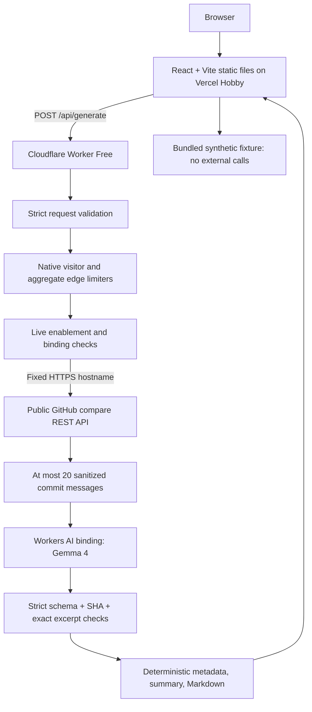

# Architecture

## System

There are two deployed units: static frontend and one Worker. The shared workspace contains code, not another service. There is no database, persistent release history, authentication, GitHub write operation, Vercel backend, or agent framework.

## Request flow and contracts

`GET /health` returns `{ status: "ok", liveEnabled: boolean, model: string }`. It makes no GitHub or inference call. Health means the handler runs and configuration is present; it does not prove upstream services are available.

`POST /api/generate` accepts JSON containing only `repositoryUrl`, `base`, and `head`. HTTPS GitHub repository URLs are normalized after validation. Branches, tags, and full/short SHAs are accepted within the conservative reference grammar; revision expressions, fork-qualified refs, spaces, and control characters are unsupported.

Success contains `mode`, `model`, `title`, `summary`, `comparison`, `entries`, `sources`, `warnings`, and `markdown`. Comparison metadata records total/processed counts, partial coverage, message shortening, and ahead/diverged status. An entry contains `category`, `text`, and one to three `{ sha, quote }` evidence records. Sources contain full SHAs and the bounded messages supplied to inference.

Errors use `{ error: { code, message, retryAfterSeconds? } }` and appropriate HTTP status. Codes distinguish invalid requests, request size, unavailable comparisons, no changes, GitHub limits/failures, AI quota/capacity/model/timeout failures, invalid output, failed grounding, disabled inference, unavailable abuse controls, and unsupported routes/methods. Retryable throttles include `Retry-After` where known. Provider details and stack traces are not exposed.

Request validation precedes costly operations. Default development returns `LIVE_AI_DISABLED` without external calls. A production-configured but disabled Worker can exercise its limiter bindings, returning disabled or throttled responses without GitHub or AI calls. Enabled requests require the verification flag, AI and both limiter bindings, and Cloudflare-provided visitor identity.

## GitHub integration

The adapter constructs one GET to `https://api.github.com/repos/{owner}/{repo}/compare/{base}...{head}?per_page=20&page=1`, with encoded coordinates/refs and redirects rejected. It never fetches the submitted URL, commit URLs, Markdown links, or a URL supplied by a model. GitHub authentication is absent, so private repositories are unsupported and 404 cannot distinguish private, missing, or unavailable refs.

GitHub returns comparisons chronologically. `total_commits` identifies partial coverage; no pagination is performed beyond the first 20. Identical/behind/empty comparisons return `NO_CHANGES`. Diverged comparisons explicitly describe the head-unique subset. Files/diffs, authors, email addresses, and unrelated metadata are not sent to the model. [GitHub compare endpoint](https://docs.github.com/en/rest/commits/commits#compare-two-commits).

## AI and source validation

The model receives a fixed system instruction plus serialized, explicitly untrusted commit data. Control characters and directional controls are removed, line endings normalized, messages bounded, and the whole prompt bounded. No tools, browsing, code execution, or secondary model calls are provided.

The native AI binding receives the documented model name, schema-formatted output, low temperature, disabled thinking, and a completion-token cap. The adapter accepts its documented chat-completion envelope and Workers-style `response` envelope; incomplete, malformed, oversized, or schema-invalid results fail. Official installed Cloudflare types check the selected model input at compile time.

Every output item must cite a retrieved full SHA and an exact excerpt from the context sent to the model. Duplicate items/evidence and invented sources fail. Breaking categories require explicit conventional-commit breaking markers; security/performance/breaking wording and numeric claims require corresponding evidence signals. These are conservative mechanical checks, not a complete semantic verifier. A misleading paraphrase can still pass; no measured accuracy claim is made.

Metadata, source URLs, and the summary are deterministic. The summary reuses the first two validated entries. Markdown is escaped and built from validated data; the UI renders structured React text and a read-only Markdown textarea. Model text never becomes unrestricted HTML, URLs, filenames, or executable code.

## Boundaries and limits

| Resource                     | Limit                                                   |
| ---------------------------- | ------------------------------------------------------- |
| Request body                 | 8 KiB, checked while reading                            |
| Repository URL / each ref    | 256 / 128 characters                                    |
| GitHub response / timeout    | 2 MiB / 10 seconds, including body consumption          |
| Commits / each model message | 20 / 800 characters                                     |
| Full prompt                  | 24,000 characters                                       |
| Completion                   | 4,096 tokens, one inference attempt                     |
| Model output                 | 48,000 characters before JSON/schema validation         |
| AI response deadline         | 45 seconds                                              |
| Browser request deadline     | 65 seconds                                              |
| Visitor / aggregate limiter  | 2 / 10 attempts per 60 seconds, per Cloudflare location |

The inference deadline cannot promise cancellation of provider computation. Failed attempts can consume free inference allocation; automatic retries are intentionally absent.

Native rate counters are approximate and location-local. A constant aggregate key is broader than a visitor key but is not a global durable budget. The free account allocation is the eventual account-wide hard boundary on Workers Free. No strict distributed budget can be claimed without additional state; that state is outside this MVP. [Cloudflare rate-limit semantics](https://developers.cloudflare.com/workers/runtime-apis/bindings/rate-limit/).

CORS permits exact configured origins, including explicitly configured localhost development origins. Non-browser requests remain possible without an Origin header. No authentication claim is attached to CORS or IP-based throttling; shared IPs may affect multiple visitors. Missing or failing protection fails closed before expensive work.

Local checks exercise actual application code with mocked GitHub, model, and limiter dependencies. The bundled demo does not make those network calls. The separately authorized public deployment verified the account plans, deployed headers, exact-origin CORS, disabled generation, and actual visitor throttling; see the evaluation record for evidence and aggregate-limit limitations. The owner subsequently authorized production live activation; one real native Gemma generation and an invalid-reference failure passed through the branded frontend. See the evaluation record for the precise verification boundary. Local/CI generation tests remain mocked.
